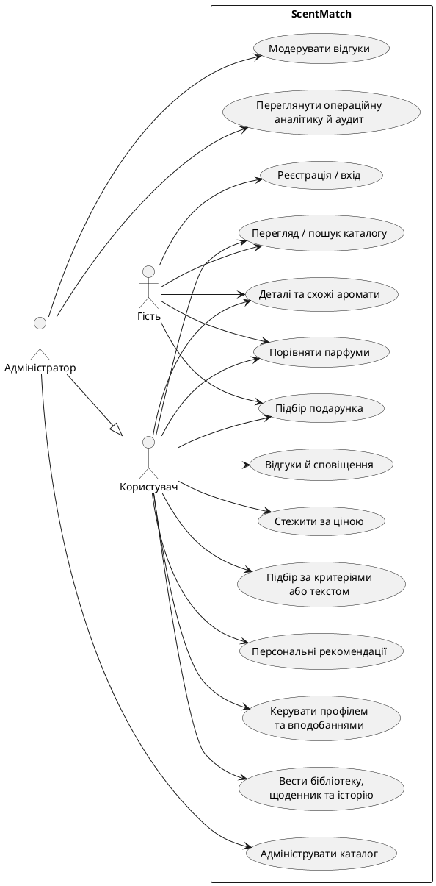
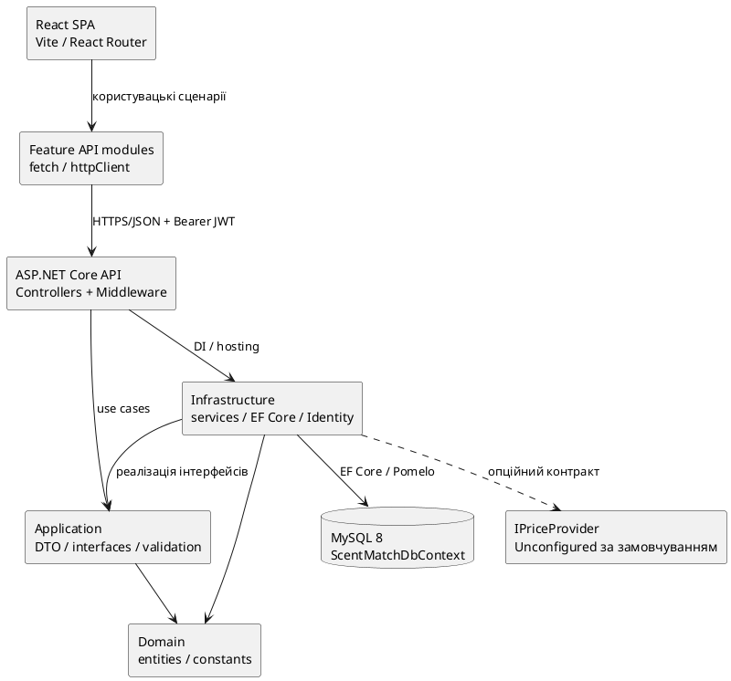
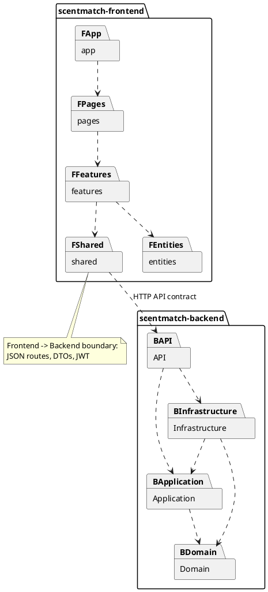
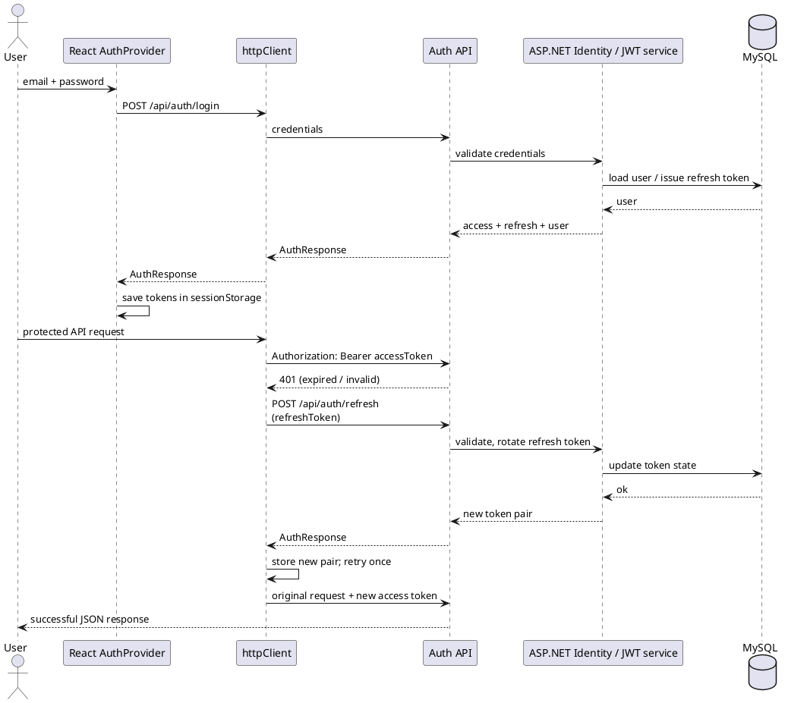
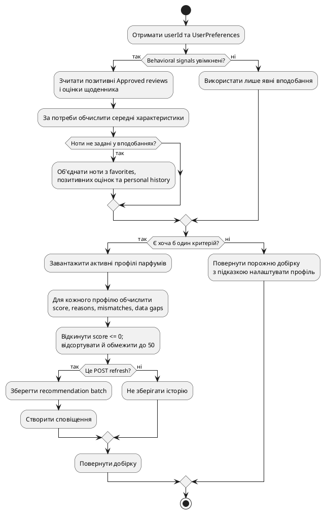
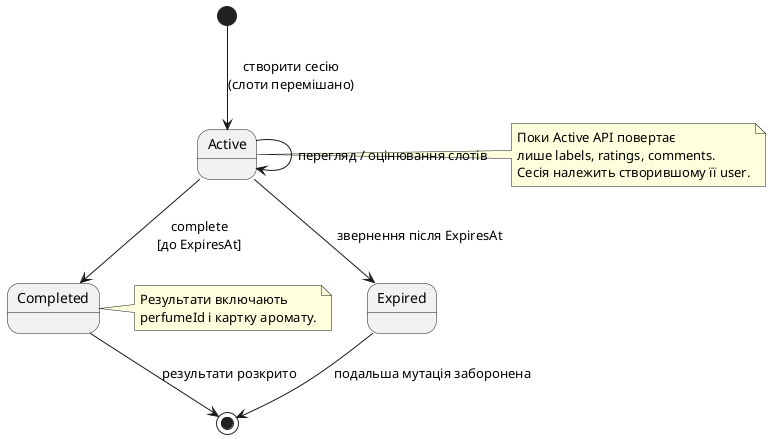
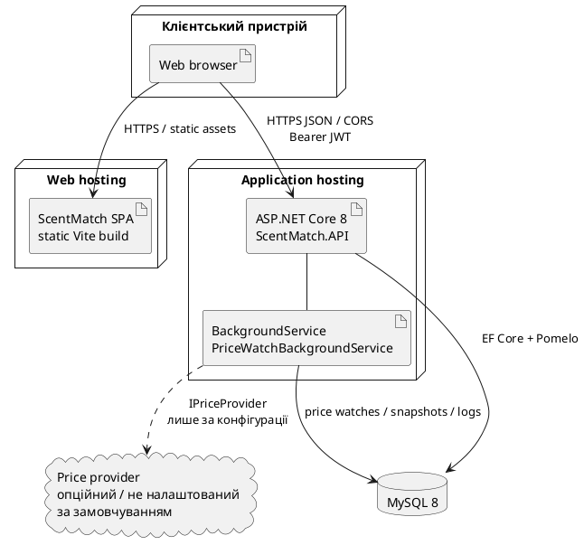

# ScentMatch — опис проєкту та технічна документація

> Документ описує стан кодових баз `scentmatch-backend` і `scentmatch-frontend`, доступних під час підготовки. Фронтенд розташований у сусідньому репозиторії `D:\project\scentmatch-frontend`, бекенд — у `D:\project\scentmatch-backend`. Перед релізом варто звірити налаштування середовища й активні міграції з цільовим середовищем.

## Зміст

1. [Призначення та можливості](#1-призначення-та-можливості)
2. [Технології й архітектура](#2-технології-й-архітектура)
3. [Функціональні модулі](#3-функціональні-модулі)
4. [Frontend](#4-frontend)
5. [Backend та API](#5-backend-та-api)
6. [Доменна модель і дані](#6-доменна-модель-і-дані)
7. [Алгоритми й бізнес-правила](#7-алгоритми-й-бізнес-правила)
8. [Безпека, обробка помилок і обмеження](#8-безпека-обробка-помилок-і-обмеження)
9. [Локальний запуск і перевірка](#9-локальний-запуск-і-перевірка)
10. [Вісім UML-діаграм](#10-вісім-uml-діаграм)
11. [Першоджерела в коді](#11-першоджерела-в-коді)

## 1. Призначення та можливості

ScentMatch — вебзастосунок для пошуку парфумів, підбору ароматів за уподобаннями, порівняння та ведення персональної колекції. Архітектурно система складається з SPA-клієнта та HTTP API.

Основні групи користувачів:

- **Гість** — переглядає й фільтрує каталог, відкриває картки ароматів, порівнює парфуми, шукає за штрихкодом і може пройти підбір подарунка.
- **Користувач** — керує профілем і вподобаннями, запускає персональний або текстовий matching, переглядає рекомендації, веде список обраного, колекції, гардероб, wishlist, щоденник, історію, відгуки, сповіщення та стежить за цінами.
- **Адміністратор** — керує каталогом і довідниками, модерує відгуки, переглядає аналітику, імпорт, якість каталогу, дублікати, інтеграції, фонові задачі й audit log.

## 2. Технології й архітектура

| Частина | Технології / призначення |
|---|---|
| Frontend | React 19, TypeScript 6, Vite 8, React Router 7, CSS Modules та спільні CSS design tokens |
| Backend | .NET 8, ASP.NET Core Web API, Controllers, middleware |
| Прикладний шар | DTO, інтерфейси сервісів, FluentValidation, опції й спільна логіка scoring |
| Домен | C# сутності та константи бізнес-правил |
| Інфраструктура | EF Core 8, Pomelo MySQL, ASP.NET Identity, сервіси доступу до даних, seed і міграції |
| База даних | MySQL 8 |
| Авторизація | JWT Bearer access token + ротаційний refresh token |
| API-документація | Swagger / OpenAPI у Development |
| Backend-тести | xUnit, `WebApplicationFactory`, EF Core InMemory |
| Frontend-перевірки | TypeScript build і Oxlint |

### Backend-шари

```text
API
  Controllers, middleware, composition root (Program.cs)
       |
Application
  DTOs, service interfaces, validators, scoring, options
       |
Domain
  Entities, constants

Infrastructure
  Implements Application interfaces; EF Core, MySQL, Identity, seed,
  migrations, matching, recommendations, integrations and background work
```

Залежності між проєктами: `API` підключає `Application` та `Infrastructure`; `Infrastructure` підключає `Application` і `Domain`; `Application` залежить від доменної моделі, а `Domain` не залежить від API чи БД.

### Frontend-шари

```text
src/
  app/        providers, routes, layouts, route guards
  pages/      сторінки та композиція сценаріїв користувача
  features/   бізнес-функції й окремі API-модулі за доменами
  entities/   типи/представлення доменних сутностей
  shared/     API HTTP-клієнт, помилки, конфігурація, UI, маршрути
  styles/     теми, глобальні стилі, типографіка
```

Frontend надсилає HTTP-запити до бекенду напряму. Окремого frontend backend-for-frontend, WebSocket/SignalR каналу чи серверного рендерингу у перевіреній реалізації не виявлено.

## 3. Функціональні модулі

| Модуль | Можливості |
|---|---|
| Обліковий запис | Реєстрація, логін, перевірка поточної сесії, оновлення та відкликання refresh token |
| Каталог | Пошук, пагінація, фільтри за брендом, типом, сезоном, нотами, ціною, рейтингом, характеристиками й сортування |
| Картка парфуму | Деталі та відгуки, схожі аромати, перехід до продавців, збереження перегляду для автентифікованого користувача |
| Порівняння | Одночасне порівняння 2–5 ароматів з аналізом спільних і відмінних властивостей |
| Matching | Підбір за сезоном, типом, нотами, ціною, інтенсивністю, концентрацією, гендером і характеристиками |
| Текстовий matching | Розбір текстового запиту українською/англійською мовами, включно з виключеннями |
| Підбір подарунка | Matching з критеріями подарункового сценарію; доступний анонімно |
| Рекомендації | Персональна добірка з уподобань і, якщо дозволено, поведінкових сигналів |
| Персональна бібліотека | Обране, власні колекції, гардероб за сценаріями, wishlist |
| Щоденник | Записи та оцінки тестування парфумів |
| Відгуки | Публічний перегляд затверджених відгуків; створення/редагування власного відгуку; модерація Admin |
| Історія | Переглянуті парфуми, параметри підбору, історія batch рекомендацій |
| Сліпе порівняння | Випадково перемішані позначені варіанти, оцінки й розкриття ароматів після завершення |
| Ціни та сповіщення | Підписки на бажану ціну, історія спостережень, inbox-сповіщення |
| Персональна аналітика | Агрегати вподобань і скидання поведінкової персоналізації |
| Адміністрування | CRUD каталогу/довідників, імпорт, якість і дублікати, dashboard, audit log, jobs, статус інтеграцій |

### API-доступ за сценарієм

Усі маршрути мають префікс `/api`.

| Доступ | Основні групи |
|---|---|
| Публічний | `GET /perfumes`, довідники, barcode lookup, відгуки, схожі аромати, `POST /comparison`, підбір подарунка |
| Автентифікований користувач | `/profile`, `/matching`, `/recommendations`, `/favorites`, `/collections`, `/journal`, `/wardrobe`, `/wishlist`, `/price-watches`, `/notifications`, `/history`, `/analytics`, `/blind-comparison` |
| Admin | `/admin/*`: каталог, модерація, dashboard, imports, якість, дублікати, audit, jobs та інтеграції |

Докладний перелік методів і контрактів наведений у [API.uk.md](./API.uk.md). Опис спільного scoring і розширень — у [PLATFORM.md](./PLATFORM.md).

## 4. Frontend

### Реалізовані сторінки та навігація

Публічні сторінки: головна, каталог, деталі парфуму, порівняння, підбір подарунка й результати підбору. Сторінки входу/реєстрації доступні гостю; сторінка Not Found обробляє невідомі маршрути.

Захищені маршрути користувача: matching, текстовий matching, рекомендації, аналітика, обране, колекції та деталі колекції, щоденник, гардероб, wishlist, цінові підписки, профіль, вподобання, історія, власні відгуки та сповіщення.

Admin-маршрути: dashboard, парфуми, бренди, ноти, сезони, типи ароматів, модерація відгуків, якість каталогу, дублікати, імпорт, audit log, jobs та інтеграції.

`ProtectedRoute` перенаправляє неавторизованого користувача на сторінку логіну зі шляхом повернення. `AdminRoute` додатково перевіряє роль для навігації; це UX-захист, а реальний контроль доступу виконує backend.

### API-клієнт і сесія

- Є спільний `httpClient`: формує URL, JSON body, query string, Bearer header, обробляє помилки, мережеві помилки та відповіді 204.
- Кожна функція-домен має окремі API-модулі у `src/features/*/api`.
- Refresh виконується при 401. Паралельні запити очікують спільний refresh Promise (single-flight); при невдалому оновленні сесія очищується.
- Access token, refresh token і строк дії зберігаються у `sessionStorage`, не в HttpOnly cookie. Доступ до токенів можливий для JavaScript у вкладці, тому захист від XSS є важливим.
- Тема Light/Dark зберігається окремо в браузері. Провайдери застосунку включають router, тему, auth, comparison, favorites і notifications.
- Frontend відображає стани завантаження/помилки для відновлення сесії; notification API опитує backend, а не використовує push/WebSocket.

### Візуальна система

Визначені CSS tokens та типографіка, світла/темна теми, палітра cream/charcoal/champagne gold, Cormorant Garamond для display і Manrope для UI, набір повторно використовуваних UI-компонентів.

### Зв’язок frontend ↔ backend

`VITE_API_BASE_URL` — базова адреса API без кінцевого `/`; локальне значення з прикладу — `http://localhost:5190`. Браузерний origin фронтенду має бути включений до `Cors:Origins` backend (типово Vite `http://localhost:5173`). Інші origins задаються конфігурацією бекенду.

Frontend модулі покривають auth, каталог, профіль, вподобання, matching, comparison, favorites, collections, reviews, history, recommendations, analytics, notifications, blind comparison, journal, wardrobe, wishlist, price watches і admin API.

## 5. Backend та API

### Життєвий цикл HTTP-запиту

1. ASP.NET Core приймає запит, застосовує routing і CORS.
2. Для захищених endpoint перевіряється Bearer JWT, строк дії, issuer/audience/signature та активність користувача.
3. Controller виконує HTTP-мапінг і делегує прикладному інтерфейсу.
4. Validator перевіряє DTO там, де він зареєстрований; сервіс застосовує бізнес-правила.
5. Infrastructure читає/записує дані через EF Core `ScentMatchDbContext` і MySQL.
6. Відповідь повертається як JSON; помилки централізовано форматує exception middleware.

### Головні API групи

| Група | Призначення |
|---|---|
| `/api/auth` | register, login, refresh, logout, `me` |
| `/api/perfumes`, `/api/brands`, `/api/notes`, `/api/seasons`, `/api/fragrance-types` | Публічний каталог та довідники |
| `/api/matching` | Персональний, текстовий та подарунковий підбір |
| `/api/recommendations`, `/api/history/recommendations` | Добірки, refresh batch та перегляд історії |
| `/api/comparison`, `/api/blind-comparison` | Звичайне й сліпе порівняння |
| `/api/profile`, `/api/analytics` | Профіль, вподобання й персоналізація |
| `/api/favorites`, `/api/collections`, `/api/wardrobe`, `/api/wishlist` | Персональна бібліотека ароматів |
| `/api/journal`, `/api/reviews` | Щоденник та відгуки |
| `/api/history/views`, `/api/history/selections` | Перегляди та критерії підбору |
| `/api/price-watches`, `/api/notifications` | Цінові підписки та inbox |
| `/api/admin/*` | Адміністрування, аналітика, аудит і операційний статус |

Звичайні списки використовують пагінацію `page` (типово 1) і `pageSize` (типово 20, максимум 100), якщо конкретний endpoint не визначає інше. API приймає JSON. Дати передаються як UTC ISO-8601.

### Каталог маршрутів

Позначення `{id}` / `{perfumeId}` — параметри шляху; доступ позначено як **Public**, **User** або **Admin**. Це короткий інвентар маршрутів; типи запитів/відповідей і правила валідації наведені в [API.uk.md](./API.uk.md).

| Група | Маршрути |
|---|---|
| Auth | `POST /auth/register`, `POST /auth/login`, `POST /auth/refresh`, `POST /auth/logout` (Public); `GET /auth/me` (User) |
| Каталог | `GET /perfumes`, `GET /perfumes/{id}`, `GET /perfumes/{id}/similar`, `GET /perfumes/by-barcode/{barcode}`, `GET /brands[/{id}]`, `GET /notes[/{id}]`, `GET /seasons[/{id}]`, `GET /fragrance-types[/{id}]` (Public) |
| Matching | `POST /matching` (User), `POST /matching/text` (User), `POST /matching/gift` (Public/User) |
| Comparison | `POST /comparison` (Public); blind comparison: `POST /blind-comparison`, `GET /blind-comparison/{sessionId}`, `PUT /blind-comparison/{sessionId}/ratings`, `POST /blind-comparison/{sessionId}/complete`, `GET /blind-comparison/{sessionId}/results` (User) |
| Профіль | `GET/PUT /profile`, `GET/PUT /profile/preferences` (User) |
| Бібліотека | `GET/POST /collections`, `GET/PUT/DELETE /collections/{id}`, `POST/DELETE /collections/{collectionId}/perfumes/{perfumeId}`, `GET /collections/export`, `POST /collections/import` (User) |
| Бібліотека | `GET /favorites`, `POST/DELETE /favorites/{perfumeId}`; `GET /wardrobe`, `GET /wardrobe/stats`, `PUT /wardrobe/assign`, `DELETE /wardrobe/{scenarioKey}/perfumes/{perfumeId}`; CRUD `/wishlist` (User) |
| Історія | CRUD `/history/views`, CRUD `/history/selections`, `GET /history/recommendations`, `GET /history/recommendations/{batchId}` (User) |
| Рекомендації й аналітика | `GET /recommendations`, `POST /recommendations/refresh`, `GET /analytics/preferences`, `POST /analytics/personalization/reset` (User) |
| Журнал і відгуки | CRUD `/journal`; `GET /perfumes/{perfumeId}/reviews`, `POST /perfumes/{perfumeId}/reviews`, `GET /perfumes/{perfumeId}/my-review`, `GET /reviews/mine`, `PUT/DELETE /reviews/{id}` |
| Ціни й сповіщення | CRUD `/price-watches`, `GET /price-watches/{id}/history`; `GET /notifications`, `GET /notifications/unread-count`, `PUT /notifications/read-all`, `PUT /notifications/{id}/read`, `DELETE /notifications[/{id}]` (User) |
| Admin | CRUD `/admin/perfumes`, `/admin/brands`, `/admin/notes`, `/admin/seasons`, `/admin/fragrance-types`; `GET /admin/reviews`, `PUT /admin/reviews/{id}/approve`, `PUT /admin/reviews/{id}/reject`, `DELETE /admin/reviews/{id}` |
| Admin-операції | `GET /admin/dashboard`, `GET /admin/catalog/quality`, `GET /admin/catalog/duplicates`, `POST /admin/catalog/import`, `GET /admin/audit-logs`, `GET /admin/jobs`, `GET /admin/integrations` |

### Рівні та залежності сервісів

- `API/Controllers` адаптують HTTP до сервісів; `API/Middleware/ExceptionHandlingMiddleware.cs` переводить винятки у відповіді API.
- `Application` задає DTO, інтерфейси сервісів, validators, options і спільну scoring-модель.
- `Infrastructure` реалізує сервіси, Identity/JWT, EF Core, інтеграційні точки, jobs і seed.
- `Domain` задає сутності та сталі значення/статуси.
- DI-композиція відбувається в `Program.cs`, `Application` та `Infrastructure` dependency-injection модулях.
- Конфігурація MySQL встановлена на MySQL 8; EF Core міграції лежать у `Infrastructure/Data/Migrations`.

### Адміністрування каталогу

Операції видалення парфумів і брендів у публічному каталозі реалізовані як soft delete через `IsActive=false`. CRUD довідників, імпорт, перевірки якості/дублікатів і модерація відгуків доступні лише ролі Admin. Є журнал адміністративних дій та журнали фонових робіт.

## 6. Доменна модель і дані

### Основні сутності

| Сутність | Роль |
|---|---|
| `User`, `Role`, `UserRole`, `RefreshToken` | Користувач, ролі та refresh-сесії |
| `UserPreferences` | Структуровані параметри підбору й налаштування персоналізації |
| `Perfume`, `Brand`, `FragranceType`, `Season`, `Note` | Каталог і довідники |
| `PerfumeNote`, `PerfumeSeason`, `PerfumeShopLink` | Багато-до-багатьох ноти/сезони та посилання на магазини |
| `FavoritePerfume`, `Collection`, `CollectionPerfume` | Обране й користувацькі колекції |
| `WishlistItem` | Намір придбання; окремий від обраного |
| `Review` | Відгук з рейтингом та статусом модерації |
| `ViewHistory`, `SelectionHistory`, `RecommendationHistory` | Перегляди, збережені підбори та batch рекомендацій |
| `ScentJournalEntry` | Особистий журнал тестування |
| `BlindComparisonSession`, `BlindComparisonSlot` | Сесія сліпого порівняння та анонімні слоти |
| `PriceWatch`, `PriceSnapshot` | Цільова ціна та часовий ряд спостережень |
| `Notification` | Повідомлення користувачу |
| `AdminAuditLog`, `BackgroundJobLog` | Адміністративний аудит і результат фонових задач |

### Важливі відношення та значення

- Користувач має вподобання та персональні записи, бібліотеки, відгуки й історію.
- Парфум має бренд і тип аромату; з нотами й сезонами зв'язаний через join-сутності; може мати кілька shop links.
- Користувач і парфум пов'язані через обране, review, wishlist, history та інші персональні сценарії.
- Колекція належить користувачу; склад колекції задає `CollectionPerfume`.
- Сесія сліпого порівняння містить позначені слоти; `PerfumeId` не розкривається клієнту до результатів.
- У характеристиках парфуму nullable означає **невідоме значення**, а не 0.
- Перегляд каталогу доступний без облікового запису; персональні дані читаються/змінюються лише у межах власника ресурсу або Admin.

## 7. Алгоритми й бізнес-правила

### Matching і схожість

Персональний matching формує активні профілі ароматів, відкидає парфуми з виключеними нотами, рахує компоненти критеріїв і повертає до 50 результатів, відсортованих за score. Нульовий score не повертається. Потрібен хоча б один критерій для звичайного matching.

Реалізовані ваги критеріїв: характеристики — 30 (розподіляються між переданими характеристиками), сезон — 20, ноти — 20, тип — 15, ціна — 15, інтенсивність — 10, концентрація — 8, гендер — 8. Це відносні ваги: score нормалізується лише за наявними в запиті критеріями та зіставними даними; при пропущених даних компонент пропускається, а прогалини повертаються окремо. Значення 0–100 — евристична оцінка відповідності, не ймовірність покупки чи вподобання.

Схожість враховує ноти, сімейство/тип, сезони, характеристики, а за наявності даних — інтенсивність і ціну. Перетин нот зважується за типом ноти (Top 1.0, Middle 1.2, Base 1.4).

### Текстовий підбір

`TextCriteriaParser` детерміновано розпізнає UA/EN критерії на кшталт нот, сезону, сімейства, бюджету, інтенсивності, концентрації та виключень (`без` / `without`). Результат проходить через спільний matching engine. Інтерфейс збагачення тексту наразі реалізований як no-op `NullTextCriteriaEnricher`; зовнішній LLM не є активною інтеграцією за замовчуванням.

### Персоналізація й рекомендації

Джерела рекомендацій: явні `UserPreferences`; якщо бажані ноти не задані — сигнали з обраного, позитивних оцінок і персональної історії підборів; якщо характеристики не задані — середні значення з високо оцінених парфумів. Поведінкові сигнали можна вимкнути або скинути. До персоналізації не входить gift/text selection history; gift history позначається окремим типом сценарію.

`GET /api/recommendations` формує поточну добірку без запису історії; `POST /api/recommendations/refresh` створює batch історії та сповіщення, якщо є результати. Рекомендації включають score breakdown, причини, невідповідності й прогалини даних.

### Відгуки, сповіщення й ціни

- Відгук починається зі статусу Pending; публічний середній рейтинг враховує лише Approved.
- Редагування відгуку знову запускає його на модерацію.
- Сповіщення зберігаються в базі та читаються polling-запитами; SignalR не використовується.
- Ціна в каталозі не тотожна ціні від магазину чи підписки.
- Фонове стеження за цінами налаштоване через `PriceTracking`; за замовчуванням провайдер `UnconfiguredPriceProvider`, який не вигадує ціни. Реальне опитування потребує впровадженого `IPriceProvider` і `PriceTracking:Enabled=true`.

### Сліпе порівняння

Backend криптографічно перемішує обрані парфуми, повертає користувачу лише лейбли A/B/… та оцінки, завершує сесію явною дією, а дані ароматів розкриває лише після завершення. Активні сесії спливають через 24 години; застаріла сесія позначається Expired під час наступного звернення.

## 8. Безпека, обробка помилок і обмеження

- JWT перевіряє issuer, audience, підпис і строк дії; під час валідації також перевіряється, що користувач існує та активний.
- Мінімальна вимога до JWT signing key — 32 символи; секрети мають надходити з environment variables або User Secrets, а не з репозиторію.
- Паролі обробляє ASP.NET Identity; мінімум 8 символів, цифра, верхній/нижній регістр і спеціальний символ.
- Захист Admin і власності даних виконує backend, незалежно від frontend route guards.
- CORS обмежується `Cors:Origins`. У production потрібно встановити тільки потрібні HTTPS origins.
- Frontend зберігає токени у `sessionStorage`. Це практичний вибір поточної реалізації, але XSS у браузерному контексті може прочитати їх; HttpOnly-cookie схема зараз не використовується.
- Типові відповіді API: 400 — некоректний запит/валідація, 401 — недійсна сесія, 403 — бракує прав або дія недоступна, 404 — об'єкт не знайдено/недоступний, 409 — конфлікт. Точний формат визначається endpoint та exception middleware.
- Публічне API приховує неактивні парфуми й бренди; приватні нотатки щоденника не є частиною admin API.
- Автоматичне scraping цін та LLM-збагачення не ввімкнені; не слід трактувати їх як наявні production-інтеграції.
- EF InMemory integration tests не замінюють перевірку на MySQL: SQL-трансляція, обмеження унікальності й міграції можуть відрізнятися.

## 9. Локальний запуск і перевірка

### Вимоги

- .NET 8 SDK
- MySQL 8.x
- Node.js і npm, сумісні з версіями у `scentmatch-frontend/package.json`

### Backend

У PowerShell із кореня `scentmatch-backend`:

```powershell
$env:ConnectionStrings__DefaultConnection="Server=localhost;Port=3306;Database=scentmatch;User=root;Password=CHANGE_ME;"
$env:Jwt__Key="LOCAL_ONLY_RANDOM_SIGNING_KEY_AT_LEAST_32_CHARACTERS"
$env:Jwt__Issuer="ScentMatch"
$env:Jwt__Audience="ScentMatchClients"
dotnet restore
dotnet ef database update --project Infrastructure --startup-project API
dotnet run --project API
```

Swagger у Development: `https://localhost:<port>/swagger`. Налаштування `Jwt:Key`, `Jwt:Issuer`, `Jwt:Audience` та `ConnectionStrings:DefaultConnection` потрібні для старту.

Seed повної демонстраційної БД:

```powershell
dotnet run --project API -- --seed-db
```

Прапорець застосовує міграції, створює demo-дані й завершує процес. Демокористувачі з README бекенду не призначені для production.

### Frontend

У PowerShell з кореня `scentmatch-frontend`:

```powershell
Copy-Item .env.example .env
npm install
npm run dev
```

У `.env` задайте `VITE_API_BASE_URL=http://localhost:5190` або фактичну адресу API. `VITE_*` значення вбудовуються в клієнтський bundle і не підходять для секретів.

### Перевірки

```powershell
# Backend
dotnet test

# Frontend
npm run build
npm run lint
```

`dotnet test` використовує EF Core InMemory. Для релізної верифікації окремо перевірте застосування міграцій і ключові сценарії проти MySQL 8 та налаштуйте production origins/секрети.

## 10. Вісім UML-діаграм

Нижче — вихідний код діаграм у синтаксисі PlantUML. Його можна зберегти як `.puml` або вставити у PlantUML-сумісний renderer. Діаграми відображають поточний дизайн/потік із коду; у спрощених діаграмах не наведені всі DTO, поля та endpoint.

### 10.1 Діаграма варіантів використання (Use Case)

Показує межі продукту, ролі та основні сценарії.



### 10.2 Діаграма компонентів (Component)

Показує SPA, API-шари, зберігання та опційного провайдера цін.



### 10.3 Діаграма пакетів (Package)

Відображає логічні пакети та напрямок залежностей у коді.



### 10.4 Діаграма класів / домену (Class)

Показує центральні сутності та зв'язки; адміністративні log-таблиці й усі поля опущені для читабельності.

```plantuml
@startuml
hide methods
skinparam classAttributeIconSize 0

class User
class Role
class UserRole
class UserPreferences
class RefreshToken
class Perfume
class Brand
class FragranceType
class Note
class PerfumeNote
class Season
class PerfumeSeason
class PerfumeShopLink
class FavoritePerfume
class Collection
class CollectionPerfume
class WishlistItem
class Review
class ViewHistory
class SelectionHistory
class RecommendationHistory
class ScentJournalEntry
class BlindComparisonSession
class BlindComparisonSlot
class PriceWatch
class PriceSnapshot
class Notification

User "1" -- "0..1" UserPreferences
User "1" -- "0..*" RefreshToken
User "1" -- "0..*" UserRole
Role "1" -- "0..*" UserRole
Brand "1" -- "0..*" Perfume
FragranceType "1" -- "0..*" Perfume
Perfume "1" -- "0..*" PerfumeNote
Note "1" -- "0..*" PerfumeNote
Perfume "1" -- "0..*" PerfumeSeason
Season "1" -- "0..*" PerfumeSeason
Perfume "1" -- "0..*" PerfumeShopLink
User "1" -- "0..*" FavoritePerfume
Perfume "1" -- "0..*" FavoritePerfume
User "1" -- "0..*" Collection
Collection "1" -- "0..*" CollectionPerfume
Perfume "1" -- "0..*" CollectionPerfume
User "1" -- "0..*" WishlistItem
Perfume "1" -- "0..*" WishlistItem
User "1" -- "0..*" Review
Perfume "1" -- "0..*" Review
User "1" -- "0..*" ViewHistory
Perfume "1" -- "0..*" ViewHistory
User "1" -- "0..*" SelectionHistory
User "1" -- "0..*" RecommendationHistory
Perfume "1" -- "0..*" RecommendationHistory
User "1" -- "0..*" ScentJournalEntry
Perfume "1" -- "0..*" ScentJournalEntry
User "1" -- "0..*" BlindComparisonSession
BlindComparisonSession "1" *-- "2..*" BlindComparisonSlot
Perfume "1" -- "0..*" BlindComparisonSlot
User "1" -- "0..*" PriceWatch
Perfume "1" -- "0..*" PriceWatch
Perfume "1" -- "0..*" PriceSnapshot
User "1" -- "0..*" Notification
@enduml
```



### 10.5 Діаграма послідовності входу й оновлення токена (Sequence)

Показує початковий login та один шлях автоматичного refresh для захищеного запиту.



### 10.6 Діаграма діяльності персональних рекомендацій (Activity)

Відображає побудову критеріїв, scoring і умовне збереження refresh batch.



### 10.7 Діаграма станів сліпого порівняння (State Machine)

Стан активної сесії, завершення й expiry; результати доступні після Completed.



### 10.8 Діаграма розгортання (Deployment)

Логічна схема розробки/production. Мережеві адреси, reverse proxy і hosting provider задаються конкретним deployment.



## 11. Першоджерела в коді

Документ узагальнює реалізацію; для точних контрактів і першоджерела перевіряйте:

- Backend: [README.md](../README.md), [API.uk.md](./API.uk.md), [PLATFORM.md](./PLATFORM.md), `API/Program.cs`, `API/Controllers`, `Application`, `Domain/Entities`, `Infrastructure`.
- Frontend: `D:\project\scentmatch-frontend\README.md`, `package.json`, `src/app/router/AppRouter.tsx`, `src/shared/api/httpClient.ts`, `src/features/*/api`, `src/features/auth/model`.
- Суміжний документ для endpoint-прикладів: [API.en.md](./API.en.md).

Якщо один з репозиторіїв змінює маршрути, типи DTO, статуси, фактори scoring або frontend route map, оновіть цей огляд та відповідні API/платформні документи.
